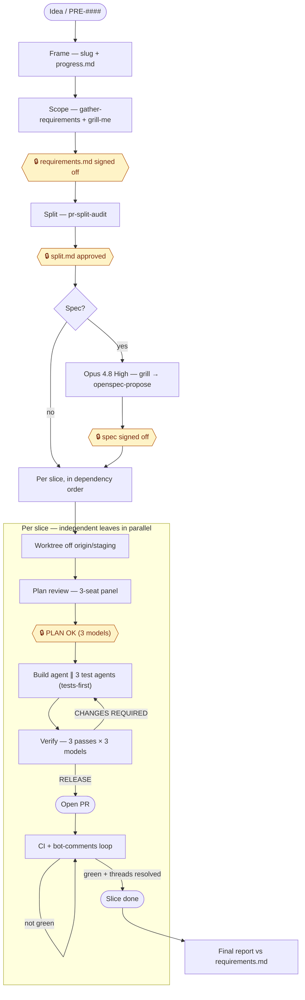

# sf — software factory

The `start-feature` pipeline as a namespaced set of `sf:` commands, so you can run the whole factory or enter at any phase and resume from saved state.

## How `start-feature` works

Idea → open PR through left-shifted, gated phases. Hexagons are **human gates** (hard stops); the per-slice build↔verify loop and the CI loop are the two cycles. State is markdown in `.scratch/<slug>/`; gates are real tool calls (review-panel verdict, lint, jest), not self-assessment.



Worker provider (build + test agents) follows `/sf:model-provider`; the review panel stays cross-vendor. The deterministic version of the per-slice loop is `sf:build-verify`.

All commands share one state contract: a state dir (`.scratch/<slug>/` in the worktree, or `~/FyxerGh/build-room/<slug>/` once a run is orchestrated or lives in a topic room; [docs/build-room.md](docs/build-room.md) describes the room's extra files) holding `progress.md` (phase checklist + gate outcomes), `requirements.md` (the locked acceptance contract), and `split.md` (the slice plan). Commands that don't take a slug locate the feature by: slug arg → current git branch → most-recently-modified `.scratch/*/progress.md` → ask.

| Command | Does |
|---|---|
| `sf:install` | Ask which reviewers (Claude Code, Codex, Cursor, Gemini), data CLI (gcloud), sheet CLI (gws) and UI checker (Claude in Chrome, the browser pane, Playwright) you use, check each is installed and logged in, and write `~/.claude/sf-tools.json`; then the OpenSpec CLI (optional Phase 2.5 spec step), the Qodo CLI (optional `pre-pr-gate` Pass E), your Slack member id (optional, for impact follow-up DMs), and the plugin settings. Run this once per machine before the rest. |
| `sf:reload [plugin\|plugin@marketplace]` | Sync the installed plugin cache from its local marketplace source (default: `sf` itself) via `claude plugin update`, then tell you to restart to pick it up. Run after editing a command in `commands/`. |
| `sf:start-feature <idea\|PRE-####>` | Full pipeline, idea → open PR. Delegates to the `start-feature` skill. |
| `sf:investigate <report>` | Start from a reported bug instead of a feature idea: grill, root-cause, problems + requirements, decide on a spec, then run the factory from Phase 2 onward. |
| `sf:continue [slug]` | Read `progress.md`, resume from the first pending phase. |
| `sf:orchestrate [slug] [--adopt]` | Run a split of more than two slices as parallel worker sessions behind one state board; `--adopt` takes over a build already under way. It also runs topic rooms: tasks that start freely, several features, light builds, an optional Linear mirror, and other runs adopted by reference. Each wake runs `room prs`, which reads every PR the room built from GitHub (read-only) into `prs.json` with their merge order; the Room UI and the build-room-view mod show it as a merge train. How its sessions talk to each other: [docs/build-room.md](docs/build-room.md). |
| `sf:adopt` | Seed the factory from this session's context (and any existing spec), cut a branch, then run `start-feature` from the first unmet gate. |
| `sf:adopt-no-plan` | Like `sf:adopt`, but infers `requirements.md` and `split.md` from the session and runs straight through build, verify and review without the plan gates. |
| `sf:adopt-from-pr [PR]` | Seed the factory from an existing PR or stack: judge whether it needs a spec, write one through `opsx:propose` if so, then green the PRs. |
| `sf:plan [idea\|PRE-####]` | Phases 0–2 only: frame, scope + lock `requirements.md`, split. Stops at split approval. |
| `sf:build [slug\|slice]` | Worktree + 3-model plan review + build + tests for a slice, as prose (model-driven). Commits locally, no push. |
| `sf:build-verify [slug]` | Same Phase 3 machine as a **deterministic Workflow**: schema'd `PLAN OK`/`RELEASE` verdicts, `parallel()` thunks over the three review seats (resolved by the entry command, since the script has no filesystem access), capped build↔verify loop over a wave of independent slices, to pre-PR RELEASE. Halts back to you for width questions. Never pushes. |
| `sf:review [branch\|PR\|slug]` | `review-feature`: gate pre-PR (3 models), open PR on RELEASE, loop CI + bots to green. |
| `sf:ci-green [PR]` | Just the CI/bot loop: `fix-bot-comments` until all checks green + threads resolved, asking before any fix that adds more complexity than the feature warrants. |
| `sf:fix-pr [PR]` | Same green-gate as `sf:ci-green`, but reviews the diff on two review seats *before* each push so fewer bot round-trips are needed. |
| `sf:models` | Set or show the model for each role (planReview, build, tests, verify), with per-run flag overrides. |
| `sf:model-provider [anthropic\|codex\|cursor]` | Switch the vendor the build and test sub-agents run on, to manage usage limits; the review panel stays cross-vendor. |
| `sf:view-agents` | Open the local agent-team dashboard (starts its dev server on :7777 first if needed). |
| `sf:room [start\|stop\|status\|rooms\|new <topic>\|close <room>\|join]` | Start, stop or check the agent-team Build Room (:7777) and Podium (:4317), and log each one's memory once a minute (`scripts/roomui`). `stop` then offers to close each room, archiving it to `~/FyxerGh/build-room/.closed/`. `join` adds the current hand-started session to a run: it asks which ticket, then appends a `join` event the orchestrator folds in. `new <topic>` opens a topic room with no contract, this session as its orchestrator, after asking once whether to mirror it to Linear. Closing a room archives its finished task sessions and prunes their worktrees only when merged, clean and named by no open ticket. |

The phase commands delegate to skills bundled with this plugin under `skills/` — `gather-requirements`, `pr-split-audit`, `solve-in-worktrees`, `review-feature`, `pre-pr-gate`, `fix-bot-comments`, `discussion-room`, `create-branch`, `create-pr`, `review-seat` (with its `codex-agent` and `cursor-agent` adapters), `query-data`, `make-sheet`, `check-ui`, `diff-review`, `commit-hang-guard`, `lint-in-ignored-worktree`, `linear-update-issue-on-pr-merge`, `prune-merged-worktrees`, `setup-worktree-webapp`, `get-worktree`, `repo-instructions`, `steward`, `build-route`, `size-change-impact` and `measure-change-impact` (both run the bundled `sf:impact-analyst` agent, and read data only through `query-data`), `fork-session` (native `start_session`) and `fork-cli-session` (`claude --bg`, where there is no desktop app), `start-feature` itself. One implementation each, no forks. `grill-me` is the one exception: it's not bundled here because it already ships in the separate `anthropic-skills` plugin, which most installs already have.

### Portability

Everything sf's commands and skills call is bundled inside this plugin (`skills/`, `agents/`, `workflows/`) and referenced via `${CLAUDE_PLUGIN_ROOT}` (or `args.pluginRoot` inside `build-verify-slice.js`, which has no filesystem access of its own) — never a hardcoded `~/.claude/skills/...` path. Installing `sf@sf` on another machine gets you the whole pipeline, no separate skill installs required.

No absolute host paths remain in any skill either. Where a skill needs the repo or a worktree, it derives the path at runtime instead of hardcoding a checkout location:
```bash
# main worktree (env-file source), and where sibling worktrees live — works wherever the repo is cloned
MAIN=$(git worktree list --porcelain | sed -n 's/^worktree //p' | head -1)
TREES_ROOT=$(dirname "$MAIN")
```
`git worktree list` always prints the main worktree first, so this resolves the same whether it's run from the main checkout or a linked worktree. Home-relative paths (the split-plan dir) use `~/.claude/plans/`, and the "don't run `tsc --noEmit`" rule now points at "the repo's `CLAUDE.md`" rather than one absolute file.

The branch author prefix is a first-class install-time setting, not a hardcoded string. The plugin declares a `branchPrefix` `userConfig` option (see `.claude-plugin/plugin.json`); Claude Code prompts for it when the plugin is first enabled and substitutes it into `create-branch` / `solve-in-worktrees` via the `${user_config.branchPrefix}` token. Leave it blank and the skills fall back to your shell username (`whoami`), so a colleague gets `alice/feat-…` with zero edits. Change it later with `/plugin configure sf`.

Three more install-time options work the same way: `prAssignee` (who `create-pr` assigns PRs to; blank means yourself, `@me`) `linearProject` (the Linear project `create-pr` searches and `linear-update-issue-on-pr-merge` checks; blank means no project filter) and `linearTeam` (the Linear team a topic room's mirror project goes in; blank means `/sf:room new` asks).

The one remaining *convention* (not a path, doesn't block install): worktrees are assumed to be siblings of the main checkout.

## `sf:build` (prose) vs `sf:build-verify` (Workflow)

`start-feature` line 18 flags its own soft spot: the phase ordering and the 3-model vote are prose the model executes by hand, so it *can* skip ahead. `sf:build-verify` is the "promote the orchestrator to a script" answer to that — the Phase 3 machine (plan-review → build + 3 test agents → 3-pass × 3-model verify → capped build↔verify loop) as `workflows/build-verify-slice.js`, where the verdicts are schema-validated objects, the 2-of-3 reconciliation is real code, the loop cap is a real loop, and an interrupted run resumes via `resumeFromRunId` instead of re-running every verify.

What stays out of the script, on purpose (a Workflow is headless and can't call `AskUserQuestion`): the width-question gate (the script returns the questions and halts the slice), the plan-ambiguity gate, and push + PR + CI. Those are the human seams `start-feature` is built around; `sf:build-verify` runs the deterministic stretch *between* them. Cross-vendor diversity is preserved where the vendors are installed: each such seat is the real Codex, Gemini or Cursor invoked from inside a thin Claude driver agent. A seat whose vendor is missing runs on a Claude model no other seat uses, and the result says so.

Use `sf:build` when you want to watch and steer a single slice; use `sf:build-verify` for a wave of independent slices you want run to RELEASE hands-off and resumable.

Editing the workflow: the script lives at `workflows/build-verify-slice.js`. Reinstall (or restart) after editing so the installed copy under `plugins/cache/` picks it up, same as the `.md` commands.

## Stay-hot mode (`--stay-hot`)

Opt-in on `sf:build` and `sf:review` to keep your own coding skill from rusting while the factory does the typing. Off by default; only fires when you pass the flag.

- On `sf:build`, at plan-release each task is scored **1–5** (whole number, 5 = "absolutely yes a human should write this") on **blast-radius + inverted build-agent confidence**. The single highest task, only if it hits **5**, is handed to you: the worktree **pauses and blocks** until you've written it, then the agents build the rest and its tests. At most one hand-off per run.
- On `sf:review`, the same score is applied to required fixes; the single highest fix, only if a **5**, is yours to write, blocking the loop until done.

Frequency is the threshold, not a percentage — only a 5 fires, so hand-offs stay rare across features. Every decision is logged (date, slug, phase, score, summary) to `~/.claude/sf-stay-hot.log`. There's no tuner yet: eyeball the log and adjust by hand if 5s fire too often or too rarely.

Not yet honoured by `sf:build-verify` (the deterministic Workflow) — that path needs a new halt reason in `workflows/build-verify-slice.js`, so for now use `sf:build` when you want stay-hot on the build phase.

## Install

Inside the `Fyxer-AI/web-app` repo the plugin is already enabled for everyone through the repo's `fyxer` marketplace, so skip the commands below there (installing `sf@sf` as well would give you two plugins named `sf`).

One line, from GitHub:

```bash
claude plugin marketplace add Dwonczykj/sf && claude plugin install sf@sf
```

Inside Claude Code: `/plugin marketplace add Dwonczykj/sf` then `/plugin install sf@sf`. Then run `/sf:install` once per machine.

This plugin is published to [`Dwonczykj/sf`](https://github.com/Dwonczykj/sf) from `local-plugins/sf/` in the config repo via `git subtree`. Edit here, then publish with `git subtree push --prefix=local-plugins/sf sf-dist main` (remote `sf-dist` → `Dwonczykj/sf`). For local dev against this working tree, point a marketplace at `~/.claude/local-plugins/sf`.

## Tools behind one door each

Each kind of outside tool has one skill that knows the vendors; everything else names the job. `/sf:install` writes the choices to `~/.claude/sf-tools.json`, and each port checks its tool at run time and falls back instead of failing the run:

| Port | Uses | Falls back to |
|---|---|---|
| `review-seat` | Codex CLI, Gemini (through Cursor or `agy`), Cursor CLI, Claude Code | a Claude sub-agent on a Claude model no other seat uses; an all-Claude panel is reported as single-vendor |
| `query-data` | gcloud (Logging, BigQuery) | "not measured" and why, never a guessed number |
| `make-sheet` | gws | a CSV plus an artifact table |
| `check-ui` | Claude in Chrome, the built-in browser pane, Playwright MCP | the gate notes that UI was not checked |
| `build-route` | the Fyxer factory (a cloud session on your Routine builds a Linear ticket, opens the PR and merges it once its gate passes), offered at each slice's build start | building locally, recommended when the slice needs local access, scores high, waits on an open PR, looks contested, or the repo has no factory |

Checks: `python3 skills/review-seat/scripts/seats_test.py`, `python3 scripts/room_test.py`, `python3 scripts/roomui_test.py`, `python3 scripts/docs_test.py` and `node scripts/build_verify_slice_test.mjs`.

## Edit

Edit the `.md` files in `commands/` directly, then reinstall (or restart) to pick up changes.

Keep the docs in the same commit as the change: a new or renamed command, skill or agent gets its README line, and a new room or roomui subcommand gets its row in [docs/build-room.md](docs/build-room.md). `scripts/docs_test.py` checks this, and the dev hook below runs it and refuses the commit when something is missing.

### Auto version bump (dev hook)

The plugin cache is keyed by `plugin.json`'s `version`, so a change shipped without a bump silently never reloads. `.githooks/pre-commit` fixes this: when a commit stages plugin files but doesn't already change the version, it bumps the patch and stages `plugin.json`. It first runs `scripts/docs_test.py` and refuses the commit if the docs miss something; any other problem just skips the bump. Install it once per clone (git can't auto-enable checked-in hooks):

```bash
# standalone Dwonczykj/sf clone (plugin at repo root):
git config core.hooksPath .githooks

# inside the config repo (plugin at local-plugins/sf) — symlink so other hooks are untouched:
ln -sf ../../local-plugins/sf/.githooks/pre-commit .git/hooks/pre-commit
```

Bump the minor/major by hand when a change warrants it; the hook only defaults the patch when you forget.
